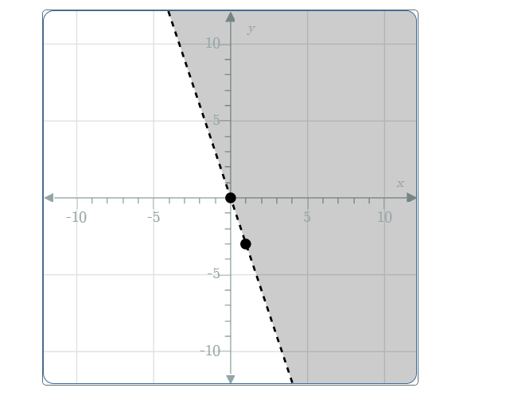
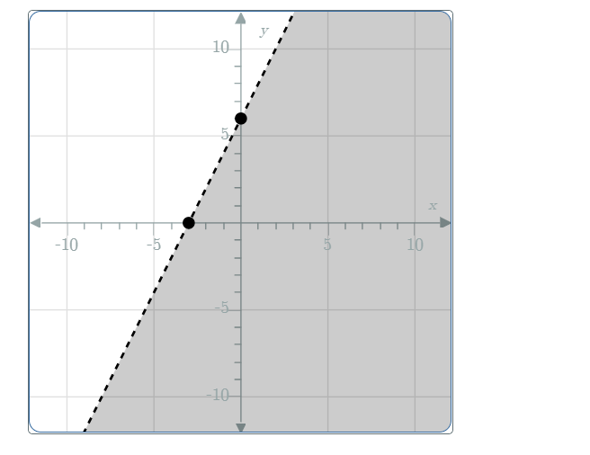

# AVP1087 — Single visual target

MathVerse:512 / MathVerse:511 · same type · Domain and solution-set constraints

## Shared or similar visual information

A straight boundary separating the shaded and unshaded parts of a coordinate plane. Compare the diagonal line between the gray and white regions in the left image with the diagonal line between the gray and white regions in the right image.

## Evidence locations

- Left image: The dashed descending diagonal separating the shaded region from the white region.
- Right image: The dashed rising diagonal separating the shaded and unshaded regions.

## Mathematical meanings

Left image: The dashed edge specifies a strict inequality, so equality points along the line are excluded. Right image: The dashed edge excludes the equality boundary of the shaded half-plane.

## Same mathematical meanings

yes

## Rationales

Both shaded regions use a dashed boundary for a strict inequality. The marked points locate each boundary line, and equality remains excluded.

## Reasoning consequence

In the left image, including the equality line would add points that the shaded solution region excludes. In the right image, treating the boundary as solid would falsely admit points lying exactly on the line.

Only the selected target is annotated. AI visual-review draft; not independently double-annotated by humans.
