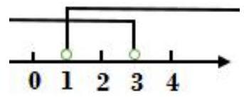

# AVP1088 — Single visual target

MV-MATH:146_2 / MV-MATH:344_4 · same type · Domain and solution-set constraints

## Shared or similar visual information

Two raised interval traces with circular boundary marks on a number line. Compare the traces attached to the marks at −3 and 4 in the left image with the traces attached to the marks at 1 and 3 in the right image.

## Evidence locations

- Left image: The two raised traces from the hollow endpoints −3 and 4, extending outward in opposite directions.
- Right image: The raised traces extending toward each other from 1 and 3, with horizontal overlap between the hollow dots.

## Mathematical meanings

Left image: The traces select x < −3 and x > 4 on opposite sides, with none of the middle values selected. Right image: Both inequalities are satisfied for values strictly between 1 and 3.

## Same mathematical meanings

no

## Rationales

The selected left cue leaves the middle interval uncovered by both traces. The selected right cue admits the middle interval in both traces, so the two constraints differ in how they admit values.

## Reasoning consequence

In the left image, reporting the middle as covered would admit 0 even though it lies on neither highlighted trace. In the right image, reading the traces as outward would incorrectly reject the shared value 2.

Only the selected target is annotated. AI visual-review draft; not independently double-annotated by humans.
