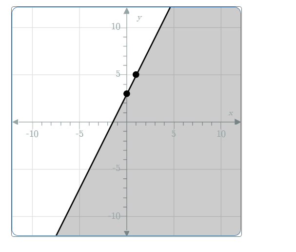
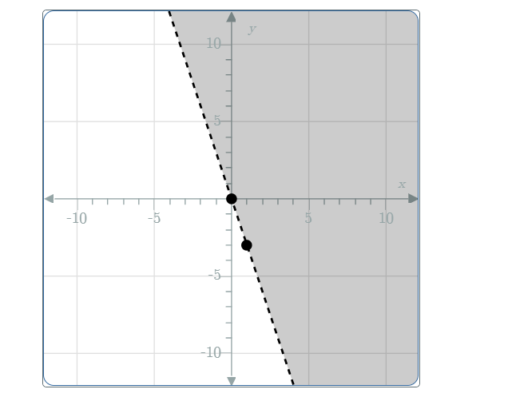

# AVP1089 — Single visual target

MathVerse:513 / MathVerse:512 · same type · Domain and solution-set constraints

## Shared or similar visual information

A straight boundary separating the shaded and unshaded parts of a coordinate plane. Compare the diagonal line between the gray and white regions in the left image with the diagonal line between the gray and white regions in the right image.

## Evidence locations

- Left image: The solid rising diagonal where the white half-plane meets the gray shading.
- Right image: The dashed descending diagonal separating the shaded region from the white region.

## Mathematical meanings

Left image: The equality line belongs to the shaded solution region. Right image: The dashed edge specifies a strict inequality, so equality points along the line are excluded.

## Same mathematical meanings

no

## Rationales

The solid line in the left image admits equality. The dashed line in the right image excludes equality, even where points have been marked to locate the line.

## Reasoning consequence

In the left image, making the edge strict would wrongly exclude (0, 3), the marked point on the vertical axis. In the right image, including the equality line would add points that the shaded solution region excludes.

Only the selected target is annotated. AI visual-review draft; not independently double-annotated by humans.
