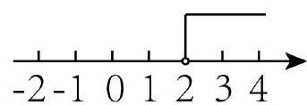
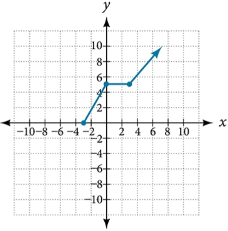

# AVP1090 — Single visual target

MV-MATH:347_4 / MathVerse:487 · different type · Domain and solution-set constraints

## Shared or similar visual information

The direction of a marked trace on a number line or function graph. Compare the raised trace attached to the number-line mark at 2 in the left image with the arrow on the blue graph trace in the right image.

## Evidence locations

- Left image: The raised trace continuing right from the hollow dot at 2.
- Right image: The blue arrow at the far end of the rising right-hand segment.

## Mathematical meanings

Left image: The ray selects values above 2. Right image: The last plotted branch continues toward larger x-values.

## Same mathematical meanings

yes

## Rationales

The selected cue in each image selects values on the larger-input side of the boundary. This gives the same local constraint rule in the two contexts.

## Reasoning consequence

In the left image, reversing the direction would wrongly include 1 and omit 3. In the right image, treating the arrow as pointing toward smaller x-values would reverse the stated direction of domain continuation.

Only the selected target is annotated. AI visual-review draft; not independently double-annotated by humans.
