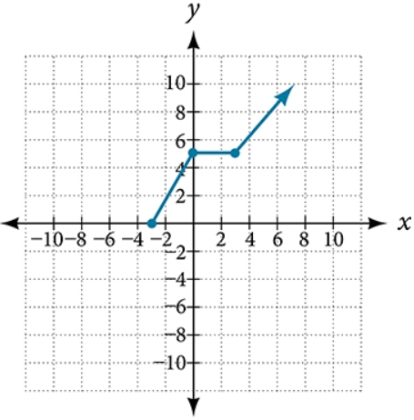
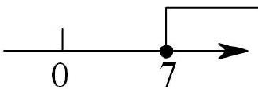

# AVP1091 — Single visual target

MathVerse:487 / MV-MATH:182_4 · different type · Domain and solution-set constraints

## Shared or similar visual information

Circular markers at boundaries of marked spans or plotted branches. Compare the marker at (−3, 0) in the left image with the marker at 7 on the number line in the right image.

## Evidence locations

- Left image: The filled dot at (−3, 0) at the left start of the blue line.
- Right image: The filled dot at 7 below the start of the raised trace that extends right.

## Mathematical meanings

Left image: The plotted piecewise function begins with an included point at x = −3. Right image: The depicted right-side interval includes its left endpoint 7.

## Same mathematical meanings

yes

## Rationales

The selected cue in each image includes the indicated boundary point. This gives the same local constraint rule in the two contexts.

## Reasoning consequence

In the left image, removing that point would incorrectly omit the left endpoint and its output 0. In the right image, dropping 7 would eliminate a valid boundary solution of x ≥ 7.

Only the selected target is annotated. AI visual-review draft; not independently double-annotated by humans.
