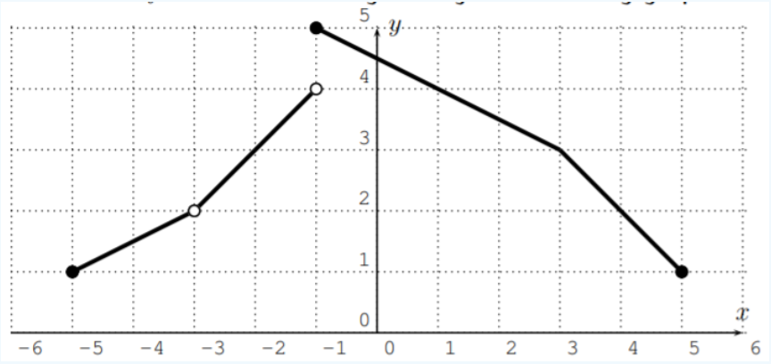
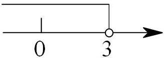

# AVP1092 — Single visual target

MathVerse:602 / MV-MATH:182_1 · different type · Domain and solution-set constraints

## Shared or similar visual information

Circular markers at boundaries of marked spans or plotted branches. Compare the upper marker at x = −1 in the left image with the marker at 3 on the number line in the right image.

## Evidence locations

- Left image: The filled dot at (−1, 5), where the declining branch starts.
- Right image: The hollow dot at 3 where the raised trace from the left meets the number line.

## Mathematical meanings

Left image: The declining branch supplies the included point (−1, 5). Right image: The depicted left-side interval excludes its right endpoint 3.

## Same mathematical meanings

no

## Rationales

The selected left cue includes the indicated boundary point. The selected right cue excludes the indicated boundary point, so the two constraints differ in how they admit values.

## Reasoning consequence

In the left image, dropping that dot would wrongly leave x = −1 without its depicted output 5. In the right image, adding 3 would turn the right endpoint of the interval from open to closed.

Only the selected target is annotated. AI visual-review draft; not independently double-annotated by humans.
