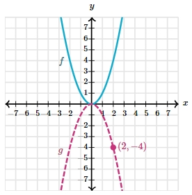
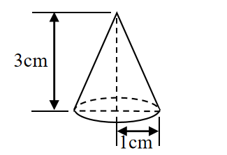

# AVP1093 — Single visual target

MathVerse:571 / We-Math:1261 · different type · Geometric markers

## Shared or similar visual information

A dashed curve.

## Evidence locations

- Left image: The dashed magenta downward-opening curve g.
- Right image: The dashed curved arc near the cone base.

## Mathematical meanings

Left image: The curve is the graph of the function g, distinguished from the solid graph f. Right image: The arc depicts the hidden rear half of the cone's base rim.

## Same mathematical meanings

no

## Rationales

In the left image, the dashed curve itself plots a function. In the right image, the dashes trace an occluded portion of a circular rim in a solid diagram.

Only the selected target is annotated. AI visual-review draft; not independently double-annotated by humans.
