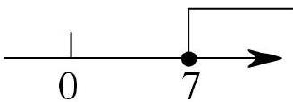
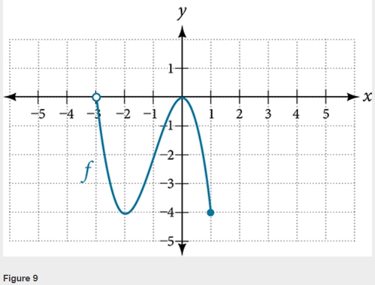

# AVP1095 — Single visual target

MV-MATH:182_4 / MathVerse:481 · different type · Domain and solution-set constraints

## Shared or similar visual information

Circular markers at boundaries of marked spans or plotted branches. Compare the marker at 7 on the number line in the left image with the marker at (1, −4) in the right image.

## Evidence locations

- Left image: The filled dot at 7 below the start of the raised trace that extends right.
- Right image: The filled blue dot at the bottom-right end of the curve, at (1, −4).

## Mathematical meanings

Left image: The depicted right-side interval includes its left endpoint 7. Right image: The plotted function includes (1, −4) as its right endpoint.

## Same mathematical meanings

yes

## Rationales

The selected cue in each image includes the indicated boundary point. This gives the same local constraint rule in the two contexts.

## Reasoning consequence

In the left image, dropping 7 would eliminate a valid boundary solution of x ≥ 7. In the right image, treating it as open would wrongly omit x = 1 from the plotted domain.

Only the selected target is annotated. AI visual-review draft; not independently double-annotated by humans.
