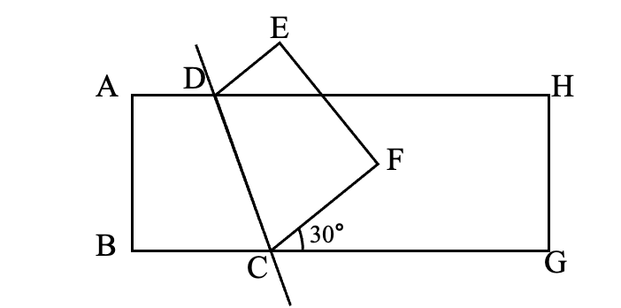
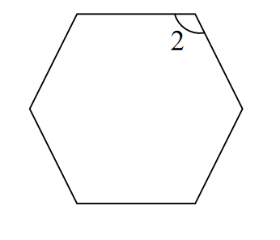

# AVP1096 — Single visual target

We-Math:1364 / We-Math:239 · same type · Geometric markers

## Shared or similar visual information

A circular arc.

## Evidence locations

- Left image: The short arc at C beside the 30-degree annotation.
- Right image: The arc at the upper-right corner of the hexagon.

## Mathematical meanings

Left image: The arc identifies the angle between CF and CG. Right image: The arc identifies the interior angle labeled 2.

## Same mathematical meanings

yes

## Rationales

Both images use the mark in the same way: the arc is drawn inside a vertex angle to show which angle is selected.

Only the selected target is annotated. AI visual-review draft; not independently double-annotated by humans.
