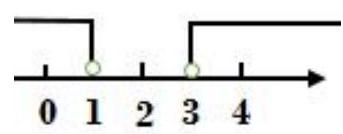
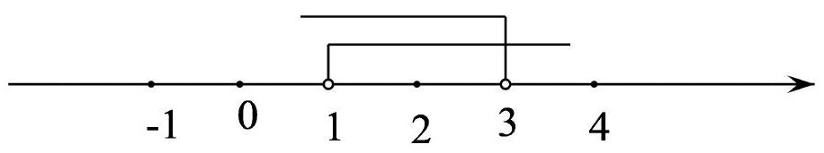

# AVP1097 — Single visual target

MV-MATH:344_3 / MV-MATH:346_1 · same type · Domain and solution-set constraints

## Shared or similar visual information

Two raised interval traces with circular boundary marks on a number line. Compare the traces attached to the marks at 1 and 3 in the left image with the traces attached to the marks at 1 and 3 in the right image.

## Evidence locations

- Left image: The raised traces extending outward from their marks at 1 and 3.
- Right image: The two raised traces crossing in horizontal coverage between the hollow dots at 1 and 3.

## Mathematical meanings

Left image: One marked ray lies below 1 and the other above 3, leaving the middle gap outside both. Right image: Both strict traces admit the middle values 1 < x < 3.

## Same mathematical meanings

no

## Rationales

The selected left cue leaves the middle interval uncovered by both traces. The selected right cue admits the middle interval in both traces, so the two constraints differ in how they admit values.

## Reasoning consequence

In the left image, reading the region between the marks as selected would wrongly admit 2. In the right image, reporting the middle as uncovered would incorrectly exclude 2 from their intersection.

Only the selected target is annotated. AI visual-review draft; not independently double-annotated by humans.
