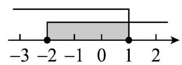
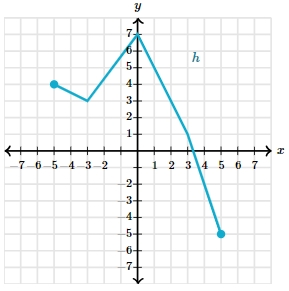

# AVP1099 — Single visual target

MV-MATH:343_2 / MathVerse:558 · different type · Domain and solution-set constraints

## Shared or similar visual information

Circular markers at boundaries of marked spans or plotted branches. Compare the marker at 1 beside the gray region in the left image with the marker at (5, −5) in the right image.

## Evidence locations

- Left image: The filled dot at 1 at the right side of the shaded region.
- Right image: The filled blue dot at the end of the steep right-hand segment at (5, −5).

## Mathematical meanings

Left image: The shaded overlap includes the upper boundary 1. Right image: The right endpoint (5, −5) is included in the graph of h.

## Same mathematical meanings

yes

## Rationales

The selected cue in each image includes the indicated boundary point. This gives the same local constraint rule in the two contexts.

## Reasoning consequence

In the left image, dropping 1 would misreport the upper end of [−2, 1]. In the right image, treating it as a hole would wrongly omit h(5) = −5.

Only the selected target is annotated. AI visual-review draft; not independently double-annotated by humans.
