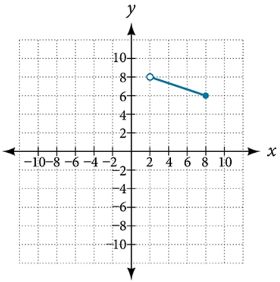

# AVP1099 — Single visual target

MathVerse:482 / We-Math:43 · different type · Geometric markers

## Shared or similar visual information

An upward arrow on a straight vertical line.

## Evidence locations

- Left image: The upward arrow at the top of the axis labeled y.
- Right image: The arrow to the left of the word North, above the right slanted line.

## Mathematical meanings

Left image: The arrow gives the increasing vertical-coordinate direction. Right image: The arrow sets the compass-direction reference for the route.

## Same mathematical meanings

no

## Rationales

In the left image, the arrow indicates the increasing direction of the vertical coordinate. In the right image, the arrow sets the compass-north reference for the geometry.

Only the selected target is annotated. AI visual-review draft; not independently double-annotated by humans.
