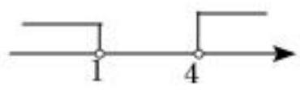
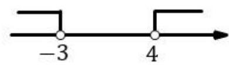

# AVP1100 — Single visual target

MV-MATH:899_2 / MV-MATH:146_2 · same type · Domain and solution-set constraints

## Shared or similar visual information

Two raised interval traces with circular boundary marks on a number line. Compare the traces attached to the marks at 1 and 4 in the left image with the traces attached to the marks at −3 and 4 in the right image.

## Evidence locations

- Left image: The raised traces extending outward from the hollow marks at 1 and 4.
- Right image: The two raised traces from the hollow endpoints −3 and 4, extending outward in opposite directions.

## Mathematical meanings

Left image: The left trace covers values below 1 and the right trace covers values above 4, leaving a gap. Right image: The traces select x < −3 and x > 4 on opposite sides, with none of the middle values selected.

## Same mathematical meanings

yes

## Rationales

The selected cue in each image leaves the middle interval uncovered by both traces. This gives the same local constraint rule in the two contexts.

## Reasoning consequence

In the left image, a bounded-interval interpretation would wrongly admit 2 despite neither trace covering it. In the right image, reporting the middle as covered would admit 0 even though it lies on neither highlighted trace.

Only the selected target is annotated. AI visual-review draft; not independently double-annotated by humans.
