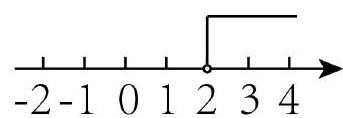
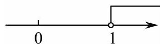

# AVP1101 — Single visual target

MV-MATH:347_4 / MV-MATH:342_2 · same type · Domain and solution-set constraints

## Shared or similar visual information

The direction of a marked trace on a number line or function graph. Compare the raised trace attached to the number-line mark at 2 in the left image with the raised trace attached to the number-line mark at 1 in the right image.

## Evidence locations

- Left image: The raised trace continuing right from the hollow dot at 2.
- Right image: The horizontal trace continuing to the right above the axis from the hollow dot at 1.

## Mathematical meanings

Left image: The ray selects values above 2. Right image: The highlighted ray selects values greater than 1.

## Same mathematical meanings

yes

## Rationales

The selected cue in each image selects values on the larger-input side of the boundary. This gives the same local constraint rule in the two contexts.

## Reasoning consequence

In the left image, reversing the direction would wrongly include 1 and omit 3. In the right image, if the ray were read as leftward, 2 would be rejected and 0 would be wrongly admitted.

Only the selected target is annotated. AI visual-review draft; not independently double-annotated by humans.
