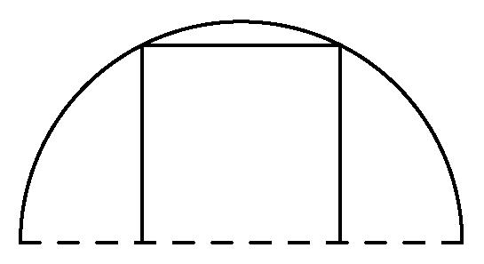
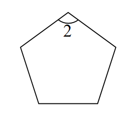

# AVP1102 — Single visual target

MathVision:2157 / We-Math:240 · same type · Geometric markers

## Shared or similar visual information

A circular arc.

## Evidence locations

- Left image: The large semicircular outline with a dashed diameter.
- Right image: The arc just below the top vertex of the pentagon.

## Mathematical meanings

Left image: The arc bounds the semicircular region enclosing the rectangle. Right image: The arc marks the interior angle labeled 2.

## Same mathematical meanings

no

## Rationales

In the left image, the arc forms a part of the boundary of a geometric figure. In the right image, the arc is drawn inside a vertex angle to show which angle is selected.

Only the selected target is annotated. AI visual-review draft; not independently double-annotated by humans.
