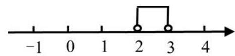

# AVP1104 — Single visual target

MathVerse:602 / MV-MATH:345_4 · different type · Domain and solution-set constraints

## Shared or similar visual information

Circular markers at boundaries of marked spans or plotted branches. Compare the lower marker at x = −1 in the left image with the marker at 2 on the number line in the right image.

## Evidence locations

- Left image: The hollow dot at (−1, 4), at the end of the increasing branch.
- Right image: The hollow circle at 2 under the left edge of the short raised span.

## Mathematical meanings

Left image: The increasing branch excludes (−1, 4) at its right boundary. Right image: The interval excludes its left boundary 2.

## Same mathematical meanings

yes

## Rationales

The selected cue in each image excludes the indicated boundary point. This gives the same local constraint rule in the two contexts.

## Reasoning consequence

In the left image, assigning 4 at x = −1 would contradict the included dot at (−1, 5). In the right image, including 2 would change (2, 3) to [2, 3).

Only the selected target is annotated. AI visual-review draft; not independently double-annotated by humans.
