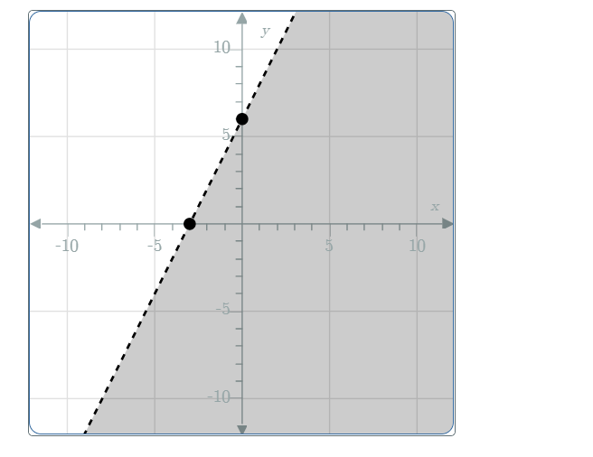

# AVP1105 — Single visual target

MathVerse:510 / MathVerse:511 · same type · Domain and solution-set constraints

## Shared or similar visual information

A straight boundary separating the shaded and unshaded parts of a coordinate plane. Compare the diagonal line between the gray and white regions in the left image with the diagonal line between the gray and white regions in the right image.

## Evidence locations

- Left image: The solid descending diagonal at the edge of the shaded region.
- Right image: The dashed rising diagonal separating the shaded and unshaded regions.

## Mathematical meanings

Left image: Points on the descending boundary satisfy the non-strict inequality represented by the shading. Right image: The dashed edge excludes the equality boundary of the shaded half-plane.

## Same mathematical meanings

no

## Rationales

The solid line in the left image admits equality. The dashed line in the right image excludes equality, even where points have been marked to locate the line.

## Reasoning consequence

In the left image, dropping those points would give the wrong answer to a membership check on the drawn edge. In the right image, treating the boundary as solid would falsely admit points lying exactly on the line.

Only the selected target is annotated. AI visual-review draft; not independently double-annotated by humans.
