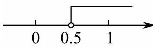

# AVP1106 — Single visual target

MathVerse:481 / MV-MATH:342_4 · different type · Domain and solution-set constraints

## Shared or similar visual information

Circular markers at boundaries of marked spans or plotted branches. Compare the marker at (−3, 0) in the left image with the marker at 0.5 on the number line in the right image.

## Evidence locations

- Left image: The hollow blue circle at the left end of the curve, at (−3, 0).
- Right image: The hollow dot at 0.5 under the start of the rightward raised line.

## Mathematical meanings

Left image: The plotted function excludes the left endpoint at x = −3. Right image: The interval excludes the lower boundary 0.5.

## Same mathematical meanings

yes

## Rationales

The selected cue in each image excludes the indicated boundary point. This gives the same local constraint rule in the two contexts.

## Reasoning consequence

In the left image, treating it as filled would falsely give the depicted function a value of 0 at x = −3. In the right image, including 0.5 would falsely give the interval a smallest member.

Only the selected target is annotated. AI visual-review draft; not independently double-annotated by humans.
