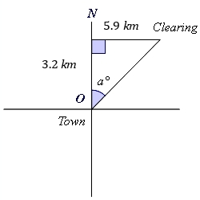
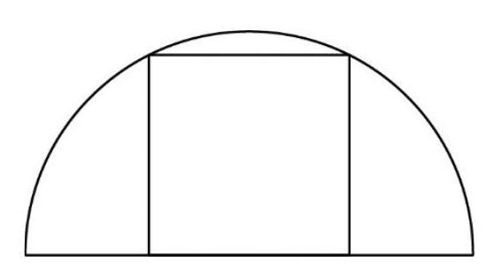

# AVP1107 — Single visual target

MathVerse:343 / MathVision:1434 · same type · Geometric markers

## Shared or similar visual information

A circular arc.

## Evidence locations

- Left image: The arc edge of the shaded wedge at the town O.
- Right image: The large semicircular outline above the baseline.

## Mathematical meanings

Left image: The arc marks the angle between the northerly direction and the direction toward the clearing. Right image: The arc is the curved boundary of the semicircular figure enclosing the rectangle.

## Same mathematical meanings

no

## Rationales

In the left image, the arc is drawn inside a vertex angle to show which angle is selected. In the right image, the arc forms a part of the boundary of a geometric figure.

Only the selected target is annotated. AI visual-review draft; not independently double-annotated by humans.
