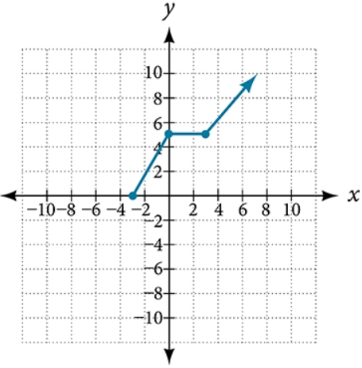
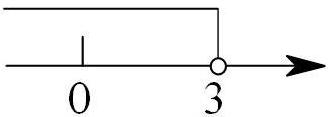

# AVP1108 — Single visual target

MathVerse:487 / MV-MATH:182_1 · different type · Domain and solution-set constraints

## Shared or similar visual information

The direction of a marked trace on a number line or function graph. Compare the arrow on the blue graph trace in the left image with the raised trace attached to the number-line mark at 3 in the right image.

## Evidence locations

- Left image: The blue arrow at the far end of the rising right-hand segment.
- Right image: The raised horizontal trace extending left away from the boundary at 3.

## Mathematical meanings

Left image: The last plotted branch continues toward larger x-values. Right image: The marked ray admits values smaller than 3.

## Same mathematical meanings

no

## Rationales

The selected left cue selects values on the larger-input side of the boundary. The selected right cue selects values on the smaller-input side of the boundary, so the two constraints differ in how they admit values.

## Reasoning consequence

In the left image, treating the arrow as pointing toward smaller x-values would reverse the stated direction of domain continuation. In the right image, reversing its direction would choose values greater than 3 instead.

Only the selected target is annotated. AI visual-review draft; not independently double-annotated by humans.
