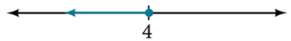
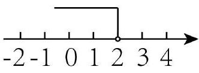

# AVP1109 — Single visual target

MathVerse:475 / MV-MATH:347_3 · same type · Domain and solution-set constraints

## Shared or similar visual information

The direction of a marked trace on a number line or function graph. Compare the blue trace attached to the number-line mark at 4 in the left image with the raised trace attached to the number-line mark at 2 in the right image.

## Evidence locations

- Left image: The arrow on the blue trace pointing left from the boundary at 4.
- Right image: The raised trace continuing left from the hollow dot at 2.

## Mathematical meanings

Left image: The highlighted ray extends over values less than 4. Right image: The ray selects values below 2.

## Same mathematical meanings

yes

## Rationales

The selected cue in each image selects values on the smaller-input side of the boundary. This gives the same local constraint rule in the two contexts.

## Reasoning consequence

In the left image, reading the black axis arrow instead of the blue trace would give the wrong side of 4. In the right image, taking the other direction would wrongly include values such as 3 and omit values such as 1.

Only the selected target is annotated. AI visual-review draft; not independently double-annotated by humans.
