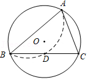

# AVP1110 — Single visual target

MathVista:700 / VisioMath:59_A · different type · Geometric markers

[Right image in official archive](https://raw.githubusercontent.com/Nefefilibata/VisioMath/4a912153e110001da261917902e1d3cc163b7c6a/data/images.zip) · `images/59_A.jpg`

## Shared or similar visual information

A dashed curve.

## Evidence locations

- Left image: The dashed arc passing through B, D and A inside the larger circle.
- Right image: The dashed arc on the end at the right of the horizontal cylinder.

## Mathematical meanings

Left image: The arc joins B and A along an auxiliary curved path through D in the planar construction. Right image: The arc traces the hidden portion of the right end rim.

## Same mathematical meanings

no

## Rationales

In the left image, the dashes give an auxiliary curved locus in a planar geometric construction. In the right image, the dashes trace an occluded portion of a circular rim in a solid diagram.

Only the selected target is annotated. AI visual-review draft; not independently double-annotated by humans.
