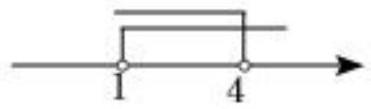

# AVP1110 — Single visual target

MV-MATH:346_4 / MV-MATH:899_4 · same type · Domain and solution-set constraints

## Shared or similar visual information

Two raised interval traces with circular boundary marks on a number line. Compare the traces attached to the marks at 1 and 3 in the left image with the traces attached to the marks at 1 and 4 in the right image.

## Evidence locations

- Left image: The raised traces terminating at the hollow dots at 1 and 3 and continuing outward.
- Right image: The two differently elevated traces with common horizontal coverage between 1 and 4.

## Mathematical meanings

Left image: The traces cover opposite sides and neither covers the middle value 2. Right image: The strict traces overlap for values between 1 and 4.

## Same mathematical meanings

no

## Rationales

The selected left cue leaves the middle interval uncovered by both traces. The selected right cue admits the middle interval in both traces, so the two constraints differ in how they admit values.

## Reasoning consequence

In the left image, reading their markings as one bounded span would incorrectly count 2 as covered. In the right image, treating them as disjoint loses common inputs such as 2.

Only the selected target is annotated. AI visual-review draft; not independently double-annotated by humans.
