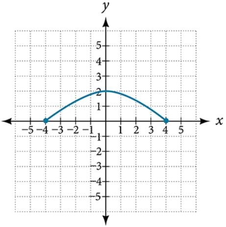
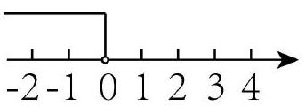

# AVP1112 — Single visual target

MathVerse:483 / MV-MATH:347_1 · different type · Domain and solution-set constraints

## Shared or similar visual information

Circular markers at boundaries of marked spans or plotted branches. Compare the marker at (4, 0) in the left image with the marker at 0 on the number line in the right image.

## Evidence locations

- Left image: The filled dot at (4, 0) at the right end of the blue arc.
- Right image: The hollow dot at 0 beneath the right end of the raised trace.

## Mathematical meanings

Left image: The plotted arc includes its right endpoint (4, 0). Right image: The interval at the left of 0 excludes 0.

## Same mathematical meanings

no

## Rationales

The selected left cue includes the indicated boundary point. The selected right cue excludes the indicated boundary point, so the two constraints differ in how they admit values.

## Reasoning consequence

In the left image, omitting the endpoint would lose the rightmost plotted zero of the function. In the right image, adding 0 would replace x < 0 with x ≤ 0.

Only the selected target is annotated. AI visual-review draft; not independently double-annotated by humans.
