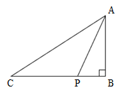

# AVP1112 — Single visual target

We-Math:244 / We-Math:180 · same type · Geometric markers

## Shared or similar visual information

An unfilled square outline.

## Evidence locations

- Left image: The four-sided outline to the right of the two octagons.
- Right image: The square at B where AB meets the triangle base.

## Mathematical meanings

Left image: The outline represents a separate square polygon in the row of figures. Right image: AB is perpendicular to BC.

## Same mathematical meanings

no

## Rationales

In the left image, the outline itself bounds a square polygon. In the right image, a square placed in the angle between two segments marks those segments as perpendicular.

Only the selected target is annotated. AI visual-review draft; not independently double-annotated by humans.
