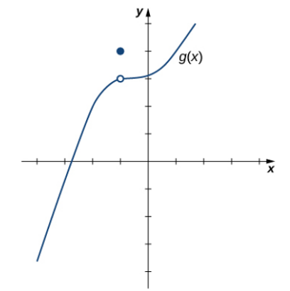
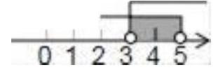

# AVP1113 — Single visual target

MathVista:37 / MV-MATH:226_1 · different type · Domain and solution-set constraints

## Shared or similar visual information

Circular markers at boundaries of marked spans or plotted branches. Compare the upper of the two vertically aligned markers in the left image with the circular marker at 3 beside the gray region in the right image.

## Evidence locations

- Left image: The filled blue dot directly above the hollow dot on the curve.
- Right image: The hollow dot at 3 on the left edge of the gray overlap.

## Mathematical meanings

Left image: The filled dot gives the actual function value at that shared input. Right image: The highlighted intersection excludes its left endpoint 3.

## Same mathematical meanings

no

## Rationales

The selected left cue includes the indicated boundary point. The selected right cue excludes the indicated boundary point, so the two constraints differ in how they admit values.

## Reasoning consequence

In the left image, dropping the filled point would falsely leave the input without an assigned function value. In the right image, including 3 would add a boundary value to the shaded solution interval.

Only the selected target is annotated. AI visual-review draft; not independently double-annotated by humans.
