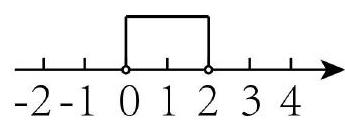
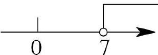

# AVP1114 — Single visual target

MV-MATH:347_2 / MV-MATH:182_3 · same type · Domain and solution-set constraints

## Shared or similar visual information

Circular markers at boundaries of marked spans or plotted branches. Compare the marker at 2 on the number line in the left image with the marker at 7 on the number line in the right image.

## Evidence locations

- Left image: The hollow dot at 2 on the right side of the raised span.
- Right image: The hollow dot at 7 below the start of the raised trace that extends right.

## Mathematical meanings

Left image: The bounded interval excludes its endpoint 2. Right image: The depicted right-side interval excludes its left endpoint 7.

## Same mathematical meanings

yes

## Rationales

The selected cue in each image excludes the indicated boundary point. This gives the same local constraint rule in the two contexts.

## Reasoning consequence

In the left image, including 2 would turn the interval (0, 2) into (0, 2]. In the right image, adding 7 would replace x > 7 with x ≥ 7.

Only the selected target is annotated. AI visual-review draft; not independently double-annotated by humans.
