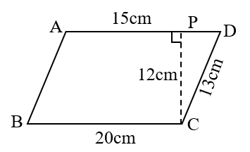

# AVP1114 — Single visual target

We-Math:1532 / MathVerse:489 · different type · Geometric markers

## Shared or similar visual information

A vertical dashed line.

## Evidence locations

- Left image: The vertical dashes labeled 12 cm running from P to C.
- Right image: The orange dashed vertical line at x = 3.

## Mathematical meanings

Left image: The line represents the perpendicular height of the trapezoid. Right image: The line marks the vertical asymptote at x = 3.

## Same mathematical meanings

no

## Rationales

In the left image, a vertical auxiliary segment marks a perpendicular height relative to a geometric base. In the right image, the dashed line marks a vertical asymptote approached by the curve.

Only the selected target is annotated. AI visual-review draft; not independently double-annotated by humans.
