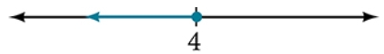
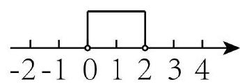

# AVP1115 — Single visual target

MathVerse:475 / MV-MATH:347_2 · same type · Domain and solution-set constraints

## Shared or similar visual information

Circular markers at boundaries of marked spans or plotted branches. Compare the marker at 4 on the number line in the left image with the marker at 2 on the number line in the right image.

## Evidence locations

- Left image: The filled blue dot at 4 on the highlighted leftward ray.
- Right image: The hollow dot at 2 on the right side of the raised span.

## Mathematical meanings

Left image: The ray includes its right endpoint 4. Right image: The bounded interval excludes its endpoint 2.

## Same mathematical meanings

no

## Rationales

The selected left cue includes the indicated boundary point. The selected right cue excludes the indicated boundary point, so the two constraints differ in how they admit values.

## Reasoning consequence

In the left image, dropping 4 would turn x ≤ 4 into x < 4. In the right image, including 2 would turn the interval (0, 2) into (0, 2].

Only the selected target is annotated. AI visual-review draft; not independently double-annotated by humans.
