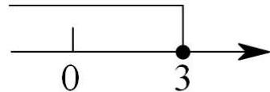

# AVP1116 — Single visual target

MV-MATH:182_2 / MathVerse:482 · different type · Domain and solution-set constraints

## Shared or similar visual information

Circular markers at boundaries of marked spans or plotted branches. Compare the marker at 3 on the number line in the left image with the marker at (8, 6) in the right image.

## Evidence locations

- Left image: The filled dot at 3 where the raised trace from the left meets the number line.
- Right image: The filled dot at (8, 6) at the right end of the blue segment.

## Mathematical meanings

Left image: The depicted left-side interval includes its right endpoint 3. Right image: The plotted segment includes its right endpoint (8, 6).

## Same mathematical meanings

yes

## Rationales

The selected cue in each image includes the indicated boundary point. This gives the same local constraint rule in the two contexts.

## Reasoning consequence

In the left image, dropping 3 would change the interval from x ≤ 3 to x < 3. In the right image, opening the endpoint would wrongly remove the value of the depicted function at x = 8.

Only the selected target is annotated. AI visual-review draft; not independently double-annotated by humans.
