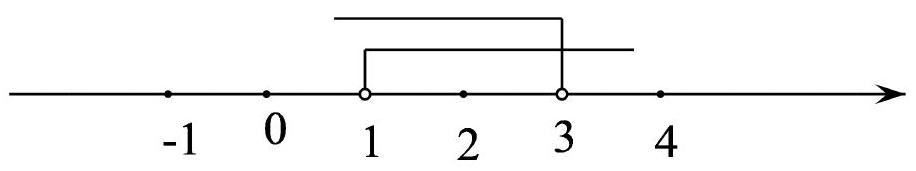
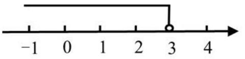

# AVP1117 — Single visual target

MV-MATH:346_1 / MV-MATH:345_1 · same type · Domain and solution-set constraints

## Shared or similar visual information

Circular markers at boundaries of marked spans or plotted branches. Compare the marker at 3 on the number line in the left image with the marker at 3 on the number line in the right image.

## Evidence locations

- Left image: The hollow dot at 3 below the termination of the upper leftward trace.
- Right image: The hollow endpoint at 3 on the leftward raised line above the axis.

## Mathematical meanings

Left image: The upper trace excludes the right boundary 3. Right image: The selected leftward ray excludes 3.

## Same mathematical meanings

yes

## Rationales

The selected cue in each image excludes the indicated boundary point. This gives the same local constraint rule in the two contexts.

## Reasoning consequence

In the left image, allowing 3 in the upper trace would also admit it to its overlap with the other trace. In the right image, including 3 would change x < 3 to x ≤ 3.

Only the selected target is annotated. AI visual-review draft; not independently double-annotated by humans.
