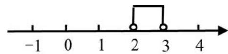
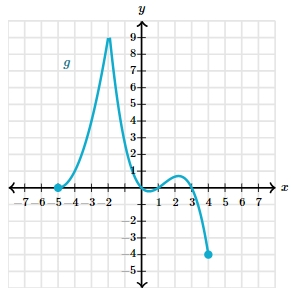

# AVP1118 — Single visual target

MV-MATH:345_4 / MathVerse:559 · different type · Domain and solution-set constraints

## Shared or similar visual information

Circular markers at boundaries of marked spans or plotted branches. Compare the marker at 2 on the number line in the left image with the marker at (−5, 0) in the right image.

## Evidence locations

- Left image: The hollow circle at 2 under the left edge of the short raised span.
- Right image: The filled blue dot at (−5, 0) at the left end of the graph of g.

## Mathematical meanings

Left image: The interval excludes its left boundary 2. Right image: The left endpoint (−5, 0) belongs to the function's graph.

## Same mathematical meanings

no

## Rationales

The selected left cue excludes the indicated boundary point. The selected right cue includes the indicated boundary point, so the two constraints differ in how they admit values.

## Reasoning consequence

In the left image, including 2 would change (2, 3) to [2, 3). In the right image, opening that endpoint would wrongly remove the leftmost zero shown.

Only the selected target is annotated. AI visual-review draft; not independently double-annotated by humans.
