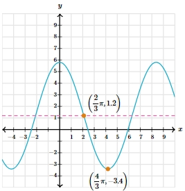

# AVP1119 — Single visual target

MathVerse:548 / MathVerse:535 · same type · Geometric markers

## Shared or similar visual information

A horizontal dashed line.

## Evidence locations

- Left image: The magenta dashed horizontal line at level 35.
- Right image: The magenta dashed horizontal line through the first orange point.

## Mathematical meanings

Left image: The line gives the sinusoid's midline at y = 35. Right image: The line gives the wave's midline at y = 1.2.

## Same mathematical meanings

yes

## Rationales

Both images use the mark in the same way: the dashed line gives the midline about which a wave oscillates.

Only the selected target is annotated. AI visual-review draft; not independently double-annotated by humans.
