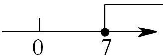

# AVP1120 — Single visual target

MathVerse:475 / MV-MATH:182_4 · same type · Domain and solution-set constraints

## Shared or similar visual information

The direction of a marked trace on a number line or function graph. Compare the blue trace attached to the number-line mark at 4 in the left image with the raised trace attached to the number-line mark at 7 in the right image.

## Evidence locations

- Left image: The arrow on the blue trace pointing left from the boundary at 4.
- Right image: The raised horizontal trace extending right away from the boundary at 7.

## Mathematical meanings

Left image: The highlighted ray extends over values less than 4. Right image: The marked ray admits values greater than 7.

## Same mathematical meanings

no

## Rationales

The selected left cue selects values on the smaller-input side of the boundary. The selected right cue selects values on the larger-input side of the boundary, so the two constraints differ in how they admit values.

## Reasoning consequence

In the left image, reading the black axis arrow instead of the blue trace would give the wrong side of 4. In the right image, reversing its direction would reject larger values and select values below 7.

Only the selected target is annotated. AI visual-review draft; not independently double-annotated by humans.
