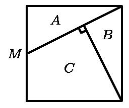

# AVP1121 — Single visual target

We-Math:1251 / MathVision:2176 · same type · Geometric markers

## Shared or similar visual information

A right-angle square.

## Evidence locations

- Left image: The square at the upper-left triangle vertex B.
- Right image: The tiny tilted square at the junction of the two interior segments.

## Mathematical meanings

Left image: AB and BC are perpendicular at B. Right image: The interior segment from the lower-right corner is perpendicular to the segment from M to the upper-right corner.

## Same mathematical meanings

yes

## Rationales

Both images use the mark in the same way: a square placed in the angle between two segments marks those segments as perpendicular.

Only the selected target is annotated. AI visual-review draft; not independently double-annotated by humans.
