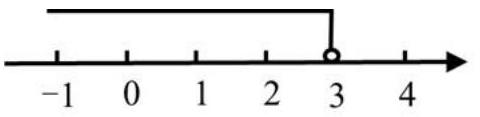
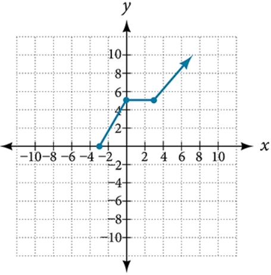

# AVP1121 — Single visual target

MV-MATH:345_1 / MathVerse:487 · different type · Domain and solution-set constraints

## Shared or similar visual information

Circular markers at boundaries of marked spans or plotted branches. Compare the marker at 3 on the number line in the left image with the marker at (−3, 0) in the right image.

## Evidence locations

- Left image: The hollow endpoint at 3 on the leftward raised line above the axis.
- Right image: The filled dot at (−3, 0) at the left start of the blue line.

## Mathematical meanings

Left image: The selected leftward ray excludes 3. Right image: The plotted piecewise function begins with an included point at x = −3.

## Same mathematical meanings

no

## Rationales

The selected left cue excludes the indicated boundary point. The selected right cue includes the indicated boundary point, so the two constraints differ in how they admit values.

## Reasoning consequence

In the left image, including 3 would change x < 3 to x ≤ 3. In the right image, removing that point would incorrectly omit the left endpoint and its output 0.

Only the selected target is annotated. AI visual-review draft; not independently double-annotated by humans.
