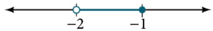
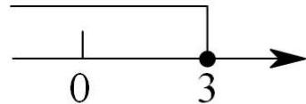

# AVP1123 — Single visual target

MathVerse:474 / MV-MATH:182_2 · same type · Domain and solution-set constraints

## Shared or similar visual information

Circular markers at boundaries of marked spans or plotted branches. Compare the marker at −1 on the number line in the left image with the marker at 3 on the number line in the right image.

## Evidence locations

- Left image: The filled blue dot at −1 at the right edge of the blue span.
- Right image: The filled dot at 3 where the raised trace from the left meets the number line.

## Mathematical meanings

Left image: The highlighted interval includes its right endpoint −1. Right image: The depicted left-side interval includes its right endpoint 3.

## Same mathematical meanings

yes

## Rationales

The selected cue in each image includes the indicated boundary point. This gives the same local constraint rule in the two contexts.

## Reasoning consequence

In the left image, dropping −1 would give the interval the wrong right bracket. In the right image, dropping 3 would change the interval from x ≤ 3 to x < 3.

Only the selected target is annotated. AI visual-review draft; not independently double-annotated by humans.
