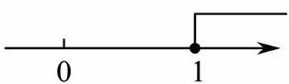

# AVP1125 — Single visual target

MathVista:37 / MV-MATH:342_1 · different type · Domain and solution-set constraints

## Shared or similar visual information

Circular markers at boundaries of marked spans or plotted branches. Compare the upper of the two vertically aligned markers in the left image with the marker at 1 on the number line in the right image.

## Evidence locations

- Left image: The filled blue dot directly above the hollow dot on the curve.
- Right image: The filled dot at 1 under the start of the rightward raised line.

## Mathematical meanings

Left image: The filled dot gives the actual function value at that shared input. Right image: The interval includes the lower boundary 1.

## Same mathematical meanings

yes

## Rationales

The selected cue in each image includes the indicated boundary point. This gives the same local constraint rule in the two contexts.

## Reasoning consequence

In the left image, dropping the filled point would falsely leave the input without an assigned function value. In the right image, dropping 1 would turn x ≥ 1 into x > 1.

Only the selected target is annotated. AI visual-review draft; not independently double-annotated by humans.
