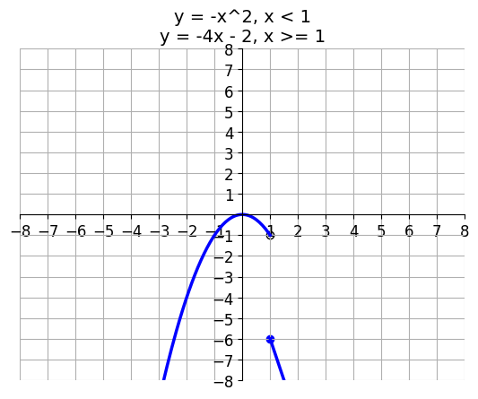
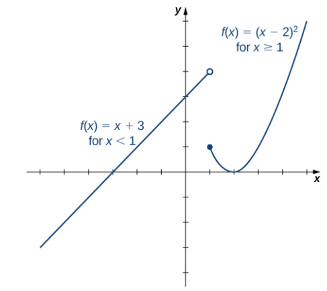

# AVP1126 — Single visual target

DynaMath:86 / MathVista:156 · same type · Domain and solution-set constraints

## Shared or similar visual information

An inequality involving x and a cutoff value beside a piecewise formula. Compare the input condition in the lower formula label in the left image with the input condition beside the straight branch in the right image.

## Evidence locations

- Left image: The x >= 1 printed after y = −4x − 2 in the second branch label.
- Right image: The x < 1 text directly below the line formula f(x) = x + 3.

## Mathematical meanings

Left image: The linear formula applies for x at least 1, including the boundary. Right image: The straight-line formula applies only to inputs less than 1.

## Same mathematical meanings

no

## Rationales

The strict < sign in the right image excludes x = 1. The comparison in the left image includes equality, so its selected rule applies at x = 1.

## Reasoning consequence

In the left image, omitting equality would leave x = 1 without the shown output −6. In the right image, allowing equality would incorrectly use the line value 4 at x = 1.

Only the selected target is annotated. AI visual-review draft; not independently double-annotated by humans.
