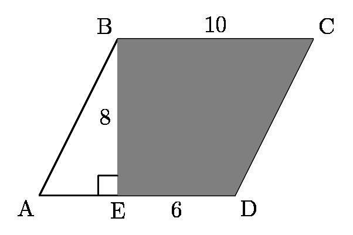
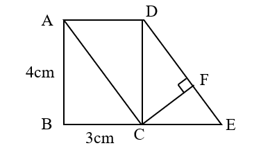

# AVP1127 — Single visual target

MathVision:2530 / We-Math:1217 · same type · Geometric markers

## Shared or similar visual information

A right-angle square.

## Evidence locations

- Left image: The square at E at the base of the segment labeled 8.
- Right image: The tilted square at F where CF meets the side DE.

## Mathematical meanings

Left image: BE is perpendicular to the horizontal base AD. Right image: CF is perpendicular to DE.

## Same mathematical meanings

yes

## Rationales

Both images use the mark in the same way: a square placed in the angle between two segments marks those segments as perpendicular.

Only the selected target is annotated. AI visual-review draft; not independently double-annotated by humans.
