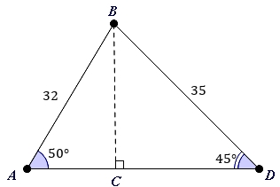
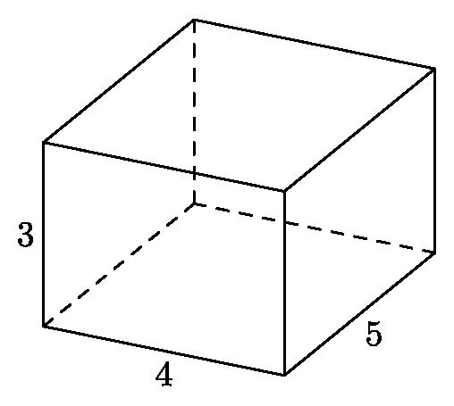

# AVP1128 — Single visual target

MathVerse:354 / MathVision:2206 · different type · Geometric markers

## Shared or similar visual information

A vertical dashed line.

## Evidence locations

- Left image: The dashed segment between B and C.
- Right image: The vertical dashed segment from the rear top corner to the junction of the three dashed edges.

## Mathematical meanings

Left image: The line represents the triangle altitude from B to AD. Right image: The line depicts the cuboid's hidden rear vertical edge.

## Same mathematical meanings

no

## Rationales

In the left image, a vertical auxiliary segment marks a perpendicular height relative to a geometric base. In the right image, the dashed vertical segment depicts an occluded edge of a solid.

Only the selected target is annotated. AI visual-review draft; not independently double-annotated by humans.
