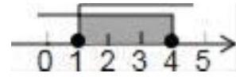
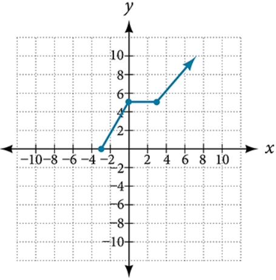

# AVP1129 — Single visual target

MV-MATH:226_4 / MathVerse:487 · different type · Domain and solution-set constraints

## Shared or similar visual information

Circular markers at boundaries of marked spans or plotted branches. Compare the circular marker at 4 beside the gray region in the left image with the marker at (−3, 0) in the right image.

## Evidence locations

- Left image: The filled dot at 4 on the right edge of the gray overlap.
- Right image: The filled dot at (−3, 0) at the left start of the blue line.

## Mathematical meanings

Left image: The highlighted intersection includes 4, its right endpoint. Right image: The plotted piecewise function begins with an included point at x = −3.

## Same mathematical meanings

yes

## Rationales

The selected cue in each image includes the indicated boundary point. This gives the same local constraint rule in the two contexts.

## Reasoning consequence

In the left image, removing 4 would incorrectly open the upper end of the shaded interval. In the right image, removing that point would incorrectly omit the left endpoint and its output 0.

Only the selected target is annotated. AI visual-review draft; not independently double-annotated by humans.
