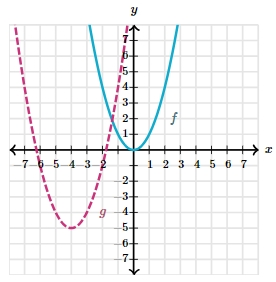

# AVP1130 — Single visual target

MathVerse:568 / VisioMath:380_A · different type · Geometric markers

[Right image in official archive](https://raw.githubusercontent.com/Nefefilibata/VisioMath/4a912153e110001da261917902e1d3cc163b7c6a/data/images.zip) · `images/380_A.jpg`

## Shared or similar visual information

A dashed curve.

## Evidence locations

- Left image: The dashed magenta upward-opening curve g.
- Right image: The dashed arc crossing the triangle side near A and the base at P.

## Mathematical meanings

Left image: The curve is the graph of the function g, distinguished from the solid graph f. Right image: The arc marks the auxiliary locus used to locate P on BC.

## Same mathematical meanings

no

## Rationales

In the left image, the dashed curve itself plots a function. In the right image, the dashes give an auxiliary curved locus in a planar geometric construction.

Only the selected target is annotated. AI visual-review draft; not independently double-annotated by humans.
