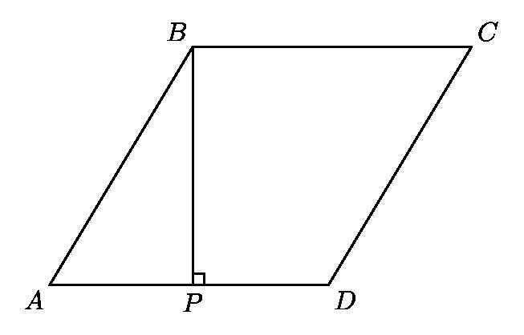

# AVP1131 — Single visual target

MathVision:2249 / MathVision:2235 · same type · Geometric markers

## Shared or similar visual information

A right-angle square.

## Evidence locations

- Left image: The square at P at the foot of BP.
- Right image: The tilted square at R where the two oblique lines cross.

## Mathematical meanings

Left image: BP is perpendicular to the base AD. Right image: PB and QC are perpendicular.

## Same mathematical meanings

yes

## Rationales

Both images use the mark in the same way: a square placed in the angle between two segments marks those segments as perpendicular.

Only the selected target is annotated. AI visual-review draft; not independently double-annotated by humans.
