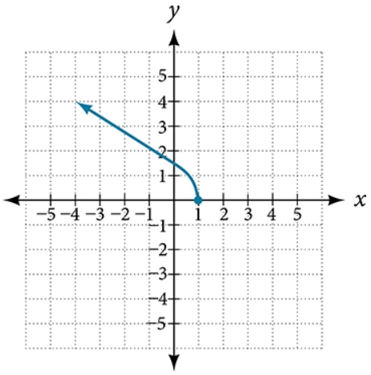
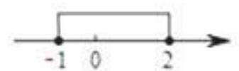

# AVP1131 — Single visual target

MathVerse:485 / MV-MATH:289_2 · different type · Domain and solution-set constraints

## Shared or similar visual information

Circular markers at boundaries of marked spans or plotted branches. Compare the marker at (1, 0) in the left image with the marker at −1 on the number line in the right image.

## Evidence locations

- Left image: The filled blue dot at (1, 0) at the right endpoint.
- Right image: The filled dot at −1 under the left edge of the raised span.

## Mathematical meanings

Left image: The plot includes the point (1, 0). Right image: The marked interval includes its left endpoint −1.

## Same mathematical meanings

yes

## Rationales

The selected cue in each image includes the indicated boundary point. This gives the same local constraint rule in the two contexts.

## Reasoning consequence

In the left image, removing that point would wrongly exclude x = 1 and delete the shown zero. In the right image, omitting −1 would remove a valid member of [−1, 2].

Only the selected target is annotated. AI visual-review draft; not independently double-annotated by humans.
