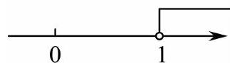
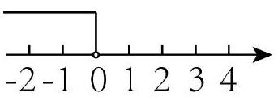

# AVP1133 — Single visual target

MV-MATH:342_2 / MV-MATH:347_1 · same type · Domain and solution-set constraints

## Shared or similar visual information

Circular markers at boundaries of marked spans or plotted branches. Compare the marker at 1 on the number line in the left image with the marker at 0 on the number line in the right image.

## Evidence locations

- Left image: The hollow dot at 1 under the start of the rightward raised line.
- Right image: The hollow dot at 0 beneath the right end of the raised trace.

## Mathematical meanings

Left image: The interval excludes the lower boundary 1. Right image: The interval at the left of 0 excludes 0.

## Same mathematical meanings

yes

## Rationales

The selected cue in each image excludes the indicated boundary point. This gives the same local constraint rule in the two contexts.

## Reasoning consequence

In the left image, adding 1 would turn x > 1 into x ≥ 1. In the right image, adding 0 would replace x < 0 with x ≤ 0.

Only the selected target is annotated. AI visual-review draft; not independently double-annotated by humans.
