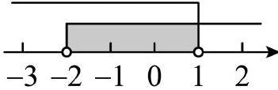

# AVP1134 — Single visual target

MathVista:156 / MV-MATH:343_3 · different type · Domain and solution-set constraints

## Shared or similar visual information

Circular markers at boundaries of marked spans or plotted branches. Compare the upper marker at x = 1 in the left image with the marker at 1 beside the gray region in the right image.

## Evidence locations

- Left image: The hollow circle at the upper end of the oblique branch, at x = 1.
- Right image: The hollow dot at 1 at the right side of the shaded region.

## Mathematical meanings

Left image: The oblique branch excludes its x = 1 endpoint. Right image: The shaded overlap excludes the upper boundary 1.

## Same mathematical meanings

yes

## Rationales

The selected cue in each image excludes the indicated boundary point. This gives the same local constraint rule in the two contexts.

## Reasoning consequence

In the left image, closing that endpoint would falsely use x + 3 at x = 1, giving 4 instead of the assigned value 1. In the right image, adding 1 would misreport the upper end of (−2, 1).

Only the selected target is annotated. AI visual-review draft; not independently double-annotated by humans.
