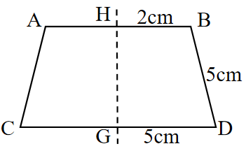
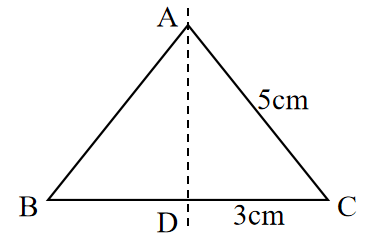

# AVP1134 — Single visual target

We-Math:116 / We-Math:115 · same type · Geometric markers

## Shared or similar visual information

A vertical dashed line.

## Evidence locations

- Left image: The vertical dashed line HG through both bases of the trapezoid.
- Right image: The vertical dashed line through A and D.

## Mathematical meanings

Left image: The line is the given symmetry axis of the trapezoid. Right image: The line is the symmetry axis through the apex and the base of the triangle.

## Same mathematical meanings

yes

## Rationales

Both images use the mark in the same way: the dashed line is the axis used to reflect a geometric figure.

Only the selected target is annotated. AI visual-review draft; not independently double-annotated by humans.
