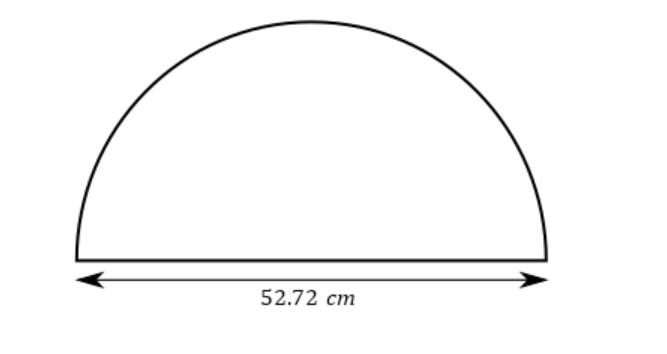
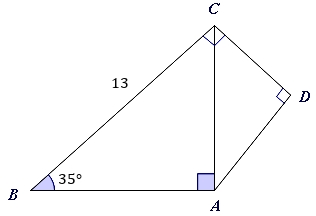

# AVP1135 — Single visual target

MathVerse:402 / MathVerse:357 · same type · Geometric markers

## Shared or similar visual information

A circular arc.

## Evidence locations

- Left image: The upper curved outline above the 52.72 cm dimension arrow.
- Right image: The arc edge of the purple wedge at B.

## Mathematical meanings

Left image: The arc is the semicircular boundary above the diameter. Right image: The arc marks the 35-degree angle between BA and BC.

## Same mathematical meanings

no

## Rationales

In the left image, the arc forms a part of the boundary of a geometric figure. In the right image, the arc is drawn inside a vertex angle to show which angle is selected.

Only the selected target is annotated. AI visual-review draft; not independently double-annotated by humans.
