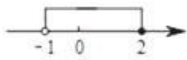
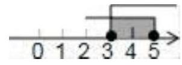

# AVP1137 — Single visual target

MV-MATH:289_1 / MV-MATH:226_2 · same type · Domain and solution-set constraints

## Shared or similar visual information

Circular markers at boundaries of marked spans or plotted branches. Compare the marker at −1 on the number line in the left image with the circular marker at 3 beside the gray region in the right image.

## Evidence locations

- Left image: The hollow dot at −1 under the left edge of the raised span.
- Right image: The filled dot at 3 on the left edge of the gray overlap.

## Mathematical meanings

Left image: The marked interval excludes its left endpoint −1. Right image: The highlighted intersection includes its left endpoint 3.

## Same mathematical meanings

no

## Rationales

The selected left cue excludes the indicated boundary point. The selected right cue includes the indicated boundary point, so the two constraints differ in how they admit values.

## Reasoning consequence

In the left image, including −1 would replace (−1, 2] with [−1, 2]. In the right image, excluding 3 would omit an allowed value from the intersection.

Only the selected target is annotated. AI visual-review draft; not independently double-annotated by humans.
